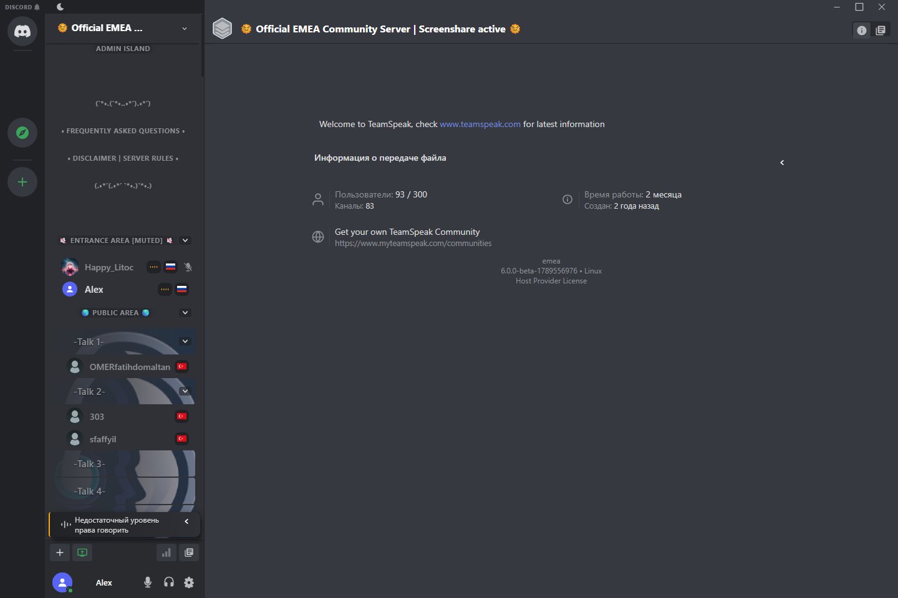
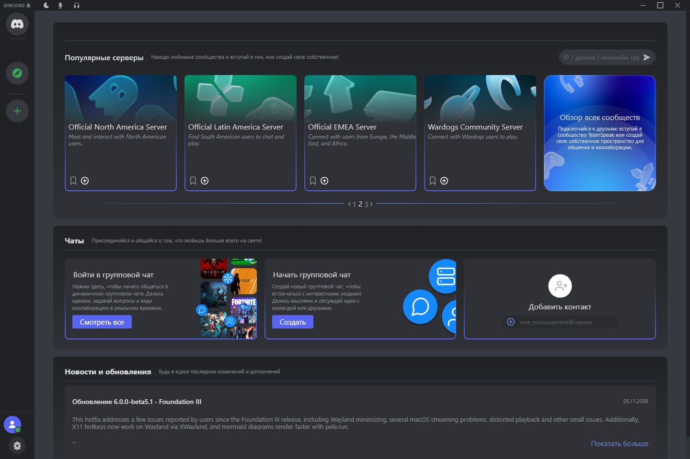
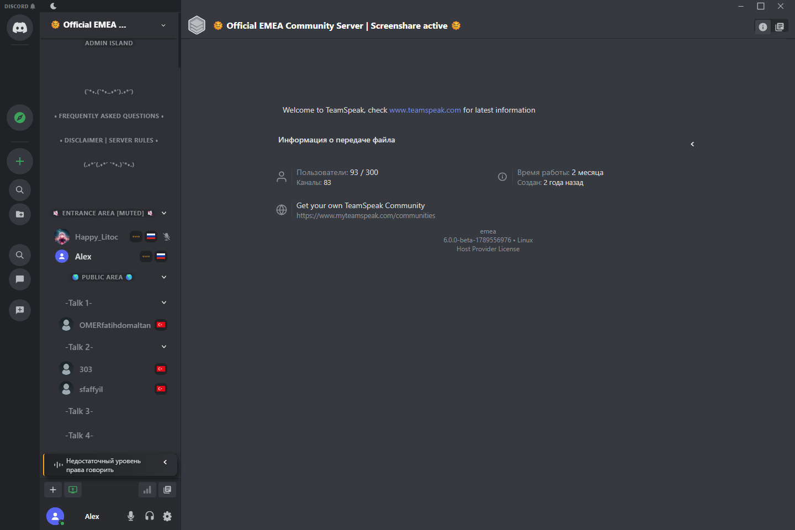
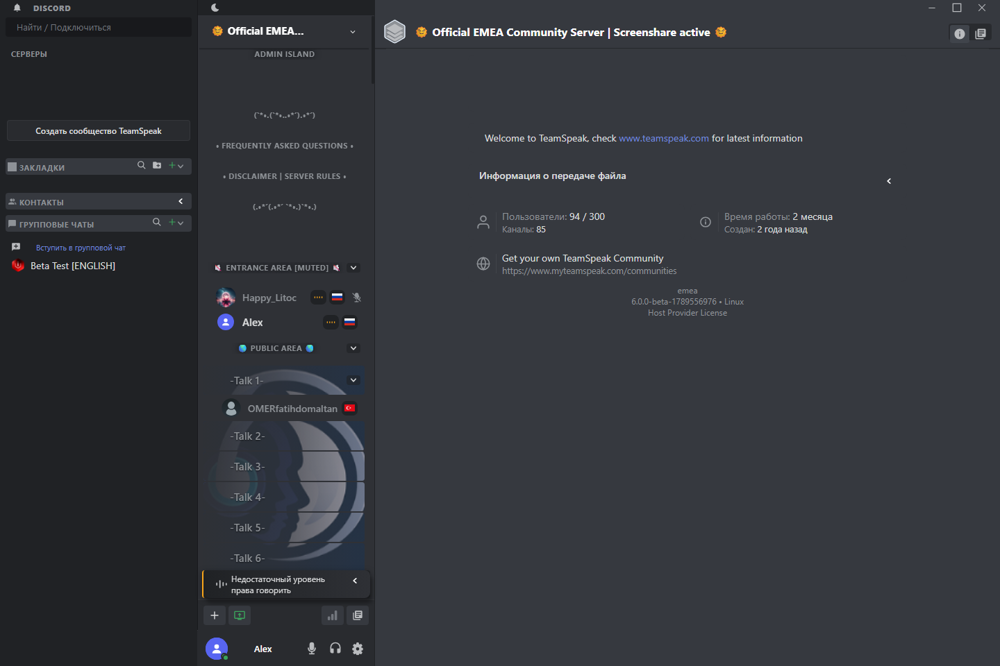
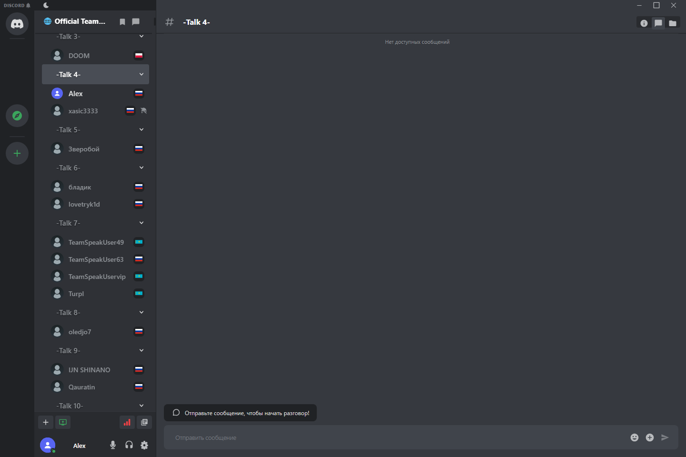

<div align="center">

# Discord Classic Dark — TeamSpeak 6

**A faithful visual & layout adaptation of TeamSpeak 6 in classic Discord Desktop Dark style**  
6 built-in theme presets · 32 monochrome vector icons · Toggleable channel banners · One-command installer

[](README.md)
[](README.en.md)


[](LICENSE)

<br/>



</div>

---

## Quick One-Command Install (Windows PowerShell)

Open **PowerShell** and run the command below — the interactive installer downloads the latest theme package, lets you choose among all 6 presets, configures `%APPDATA%\TeamSpeak` safely (creating a `settings.db.bak` backup), and optionally restarts TeamSpeak 6:

```powershell
irm https://raw.githubusercontent.com/Roskud/teamspeak6-discord-theme/main/install.ps1 | iex
```

> [!TIP]
> **Non-interactive install** (for example, recommended `Discord Rail + Banners` with auto-restart):
> ```powershell
> $s = irm https://raw.githubusercontent.com/Roskud/teamspeak6-discord-theme/main/install.ps1
> & ([ScriptBlock]::Create($s)) -Preset 4 -AutoRestart
> ```

---

## 6 Built-In Presets (All Installed Together)

Switch between any preset at any time directly inside TeamSpeak 6:  
**Settings → Appearance → Theme**

| # | Preset | Sidebar Layout | Channel Banners | Best For |
|---|---|---|---|---|
| **1** | **Discord Dark** | Full `72px` rail | Flat channel rows | Keeping bookmarks, contacts, group chats, and servers visible |
| **2** | **Discord Dark + Banners** | Full `72px` rail | With channel art | Full rail navigation plus channel banner artwork |
| **3** | **Discord Rail** | Minimalist `72px` rail | Flat channel rows | Distraction-free Discord rail during voice calls |
| **4** | **Discord Rail + Banners** *(Recommended)* | Minimalist `72px` rail | With channel art | **Best balance**: clean Discord guild rail + channel banners |
| **5** | **Discord Wide** | Wide navigation pane | Flat channel rows | Readable text labels for servers, folders, and chats |
| **6** | **Discord Wide + Banners** | Wide navigation pane | With channel art | Full labeled sidebar navigation with channel banners |

---

## Features & UI Overhaul

- **Authentic Discord Desktop Dark Palette** — `#202225` guild rail, `#2f3136` channel tree & sidebar, `#36393f` main view & chat canvas, `#292b2f` user dock, and `#40444b` message input composer.
- **Discord-Style `72px` Guild Rail**:
  - **Discord logo Home button** (`#36393f` idle → `#5865F2` on hover/active).
  - Circular `48×48` server avatars (`border-radius: 50%`, smooth `16px` squircle transition on hover/selection, and classic white left **pill indicator**).
  - Left-click hover **`[×]` disconnect badge** on connected servers for fast one-click server disconnect.
  - Green **`+` Add Server** and **Compass (Explore Communities)** buttons — **`+` works reliably both on Home and while connected to a server**.
  - Eliminates duplicate active-server icons in Bookmarks (`install.ps1` sets `keepActiveItemsInList = false`).
- **Relocated `52px` Bottom User Dock**:
  - In split server view, the user card (avatar, presence status dot, username, **Mic, Deafen, and Settings controls**) moves cleanly beneath the channel tree just like Discord.
  - Automatically returns to the left rail on Home and in Settings without overlapping panels.
- **Clean Channel Tree & Optional Channel Banners**:
  - Centered `[cspacer]` and right-aligned `[rspacer]` section headers without cluttering fake arrows.
  - Crisp `#43b581` green speaking outline on `24×24` circular member avatars.
  - Choose between **with channel banner artwork (`+ Banners`)** and **clean flat rows**.
- **Flat Channel Chat & Native Overlays**:
  - Flat Discord-styled messages with `40×40` avatars, mention highlights, `#40444b` composer bar, and themed context menus, Quick Switcher, Settings panel, and fullscreen video layout.
- **32 Custom Monochrome Vector Icons**:
  - Replaces 3D TeamSpeak icons with clean Discord SVG icons (mic, deafen, gear, voice/locked channels, emoji, upload, send, etc.).
  - Every SVG is embedded directly inside `.css` via `data:image/svg+xml` — zero external CDN calls or broken offline assets.

---

## Screenshots

<details open>
<summary><b>Theme Showcase Gallery</b></summary>

| Home & Community Discovery | Connected Server with Channel Banners (`Discord Rail + Banners`) |
|---|---|
|  |  |

| Full `72px` Rail & Flat Channels (`Discord Dark`) | Wide Navigation + Channel Banners (`Discord Wide + Banners`) |
|---|---|
|  |  |

| Channel Chat & Relocated Bottom Dock (`#40444b` / `#292b2f`) |
|---|
|  |

</details>

---

## Installation Methods

### 1. One-Command PowerShell Install (Online)

```powershell
irm https://raw.githubusercontent.com/Roskud/teamspeak6-discord-theme/main/install.ps1 | iex
```

### 2. From Cloned Repository

```powershell
git clone https://github.com/Roskud/teamspeak6-discord-theme.git
cd teamspeak6-discord-theme
powershell -ExecutionPolicy Bypass -File .\install.ps1
```

Supported `install.ps1` flags:

| Flag | Description |
|---|---|
| `-Preset <1..8>` | Choose an option non-interactively (`1..6` presets, `7` copy files only, `8` uninstall) |
| `-ProfileName "<Name>"` | Target a specific profile under `%APPDATA%\TeamSpeak` when multiple profiles exist |
| `-AutoRestart` | Gracefully close TeamSpeak 6 (flushing SQLite WAL), apply theme/settings, and relaunch |
| `-NoRestart` | Copy extension / update configuration without restarting TeamSpeak 6 |
| `-Uninstall` | Remove `dev.custom.discord` and restore default TeamSpeak appearance settings |
| `-RepoArchiveUrl "<URL>"` | Override the ZIP archive URL when running remotely |

### 3. Manual Installation

1. Download the repository (**Code → Download ZIP**) and extract it (or `git clone`).
2. Completely close **TeamSpeak 6** (including from the system tray).
3. Copy the contents of `extension/` (`package.json`, `preview.svg`, `*.css`, and the `icons/` folder) into:
   ```text
   %APPDATA%\TeamSpeak\Default\extensions\dev.custom.discord
   ```
   *(Verify that `...\dev.custom.discord\package.json` exists directly inside that folder.)*
4. Launch **TeamSpeak 6**, go to **Settings → Appearance → Theme**, and choose any `Discord ...` variant (e.g. `Discord Rail + Banners`).

---

## Building from Source

All 6 CSS themes and `extension/package.json` are generated by `scripts/build.py` (Python 3):

```powershell
python scripts/build.py
```

The script inlines all SVGs from `extension/icons/*.svg` directly into the generated stylesheets and validates CSS brace/parenthesis balance.

---

## Uninstall

Run `.\install.ps1` and pick `[8] Uninstall`, or run:

```powershell
powershell -ExecutionPolicy Bypass -File .\install.ps1 -Uninstall -AutoRestart
```

Only the `dev.custom.discord` extension directory is removed and TeamSpeak settings are cleanly restored (a `settings.db.bak` backup is also preserved).

---

## License

Released under the [MIT License](LICENSE).
