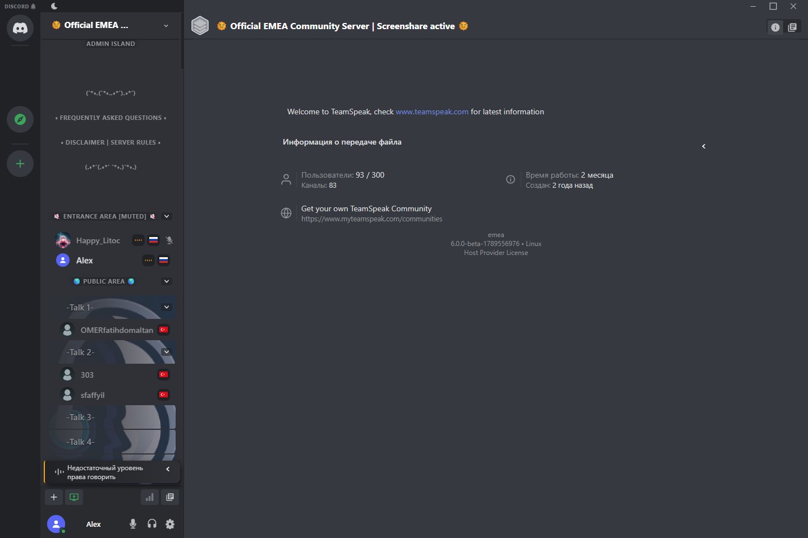
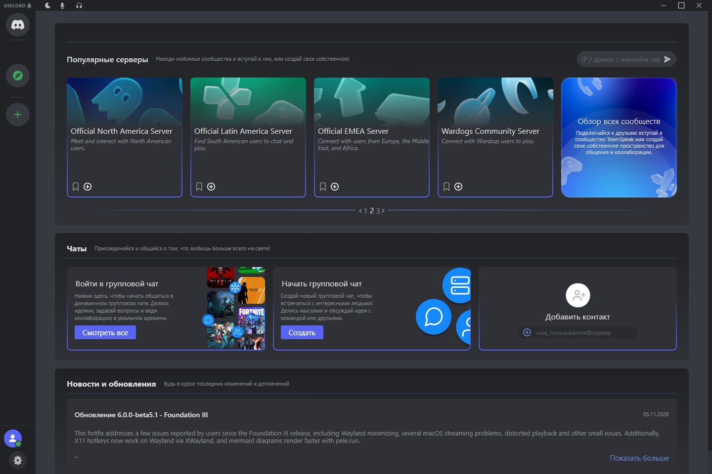
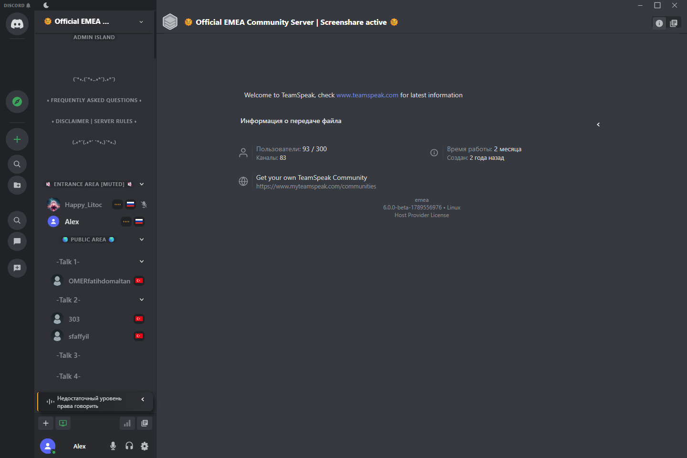
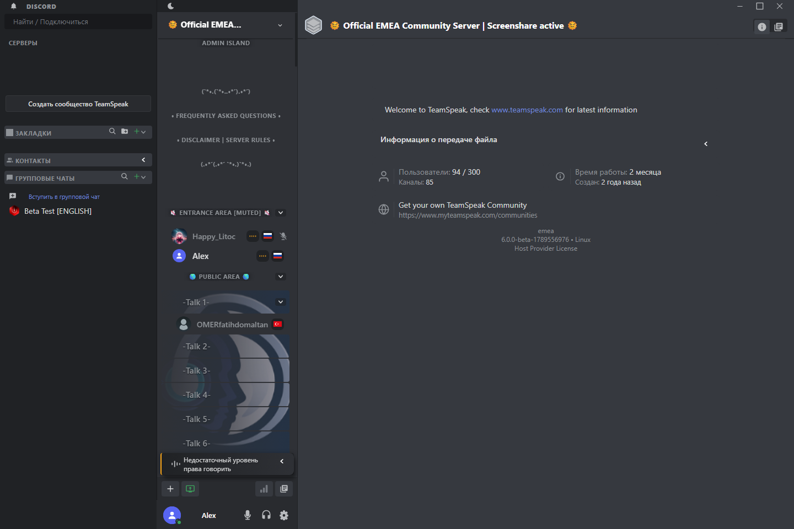
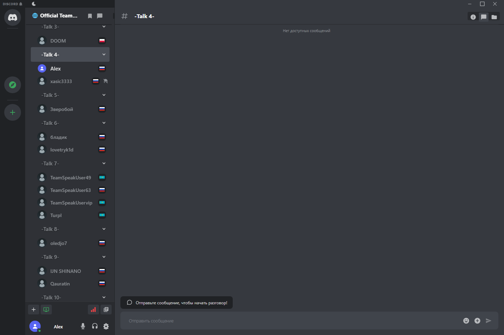

<div align="center">

# Discord Classic Dark — TeamSpeak 6

**Полная визуальная и эргономическая адаптация TeamSpeak 6 в стиле классического Discord Desktop Dark**  
6 вариантов темы в одном расширении · Кастомные векторные иконки · Баннеры каналов на выбор · Установка в 1 команду

[](README.md)
[](README.en.md)


[](LICENSE)

<br/>



</div>

---

## Быстрая установка в 1 команду (Windows PowerShell)

Откройте **PowerShell** и выполните команду — интерактивный установщик сам скачает последнюю версию темы, предложит выбрать один из 6 режимов (плюс синхронизацию файлов `[7]` и удаление `[8]`), настроит расширение в `%APPDATA%\TeamSpeak` (с однократной резервной копией `settings.db.bak`) и при желании перезапустит TeamSpeak 6:

```powershell
irm https://raw.githubusercontent.com/Roskud/teamspeak6-discord-theme/main/install.ps1 | iex
```

> [!TIP]
> **Установка конкретного пресета без меню** (например, рекомендуемый `Discord Rail + Banners` с автоперезапуском):
> ```powershell
> $s = irm https://raw.githubusercontent.com/Roskud/teamspeak6-discord-theme/main/install.ps1
> & ([ScriptBlock]::Create($s)) -Preset 4 -AutoRestart
> ```

---

## 6 готовых вариантов темы (устанавливаются сразу все)

Переключаться между любыми вариантами можно в любой момент прямо внутри клиента:  
**Settings → Appearance → Theme**

| # | Вариант | Режим панели | Баннеры каналов | Кому подойдёт |
|---|---|---|---|---|
| **1** | **Discord Dark** | Полная лента `72px` | Плоские строки | Всегда под рукой закладки, контакты, чаты и серверы |
| **2** | **Discord Dark + Banners** | Полная лента `72px` | С картинками | То же самое, но с красивыми баннерами каналов |
| **3** | **Discord Rail** | Минимализм `72px` | Плоские строки | Чистый интерфейс Discord во время звонка (минимум лишнего) |
| **4** | **Discord Rail + Banners** *(рекомендуется)* | Минимализм `72px` | С картинками | **Лучший баланс**: классическая лента Discord + цветные баннеры каналов |
| **5** | **Discord Wide** | Широкая панель | Плоские строки | Удобно, если нужны текстовые названия серверов, папок и чатов |
| **6** | **Discord Wide + Banners** | Широкая панель | С картинками | Широкая навигация с подписями + баннеры каналов |

---

## Возможности и изменения интерфейса

- **Оригинальная цветовая схема Discord Desktop Dark** — `#202225` лента серверов, `#2f3136` дерево каналов и список участников, `#36393f` основное окно и чат, `#292b2f` нижняя панель профиля и `#40444b` поле ввода сообщений.
- **Левая панель серверов (`72px`) как в Discord**:
  - Кнопка **Домой / Быстрый переход** в стиле логотипа **Discord** (`#36393f` → `#5865F2` при наведении и активации).
  - Круглые иконки серверов `48×48` (`border-radius: 50%`, плавный скруглённый квадрат `16px` при наведении и выборе, белый левый **pill-индикатор**).
  - Удобная кнопка отключения **`[×]`** — появляется при наведении в углу активного сервера и отключает левым кликом без лишних меню.
  - Зелёные кнопки **`+` Добавить сервер** и **Компас (Обзор сообществ)** — кнопка **`+`** работает всегда, в том числе когда вы уже подключены к голосовому серверу.
  - Отсутствие дублирования активного сервера в списке закладок (установщик автоматически выставляет `keepActiveItemsInList = false`).
- **Перенесённый нижний User Dock (`52px`)**:
  - В режиме открытого сервера панель профиля с аватаром, статусом (`Онлайн / Отошёл / Не беспокоить`), ником, **кнопками Микрофона, Наушников и Настроек** перенесена ровно под колонку каналов — один в один как в Discord.
  - На главном экране и в настройках док автоматически возвращается в левую панель, не перекрывая интерфейс.
- **Чистое дерево каналов и баннеры на выбор**:
  - Аккуратно оформленные категории и разделители каналов (`[cspacer]` по центру, `[rspacer]` справа).
  - Чёткое зелёное кольцо говорящего (`#43b581`) вокруг круглой аватарки участника (`24×24`).
  - Отдельные варианты темы **с картинками/баннерами каналов (`+ Banners`)** и **без них**.
- **Плоский чат канала и поп-апы**:
  - Плоские сообщения в стиле Discord с аватарами `40×40`, выделением упоминаний, компактной строкой ввода `#40444b`, стилизованными контекстными меню, настройками, видеозвонками (включая полноэкранный режим) и Quick Switcher.
- **32 кастомные векторные SVG-иконки**:
  - Все 3D-иконки TeamSpeak заменены на монохромные иконки Discord (микрофон, наушники, шестерёнка, голосовые/закрытые каналы, эмодзи, скрепка, отправка и т.д.).
  - Иконки запечены прямо внутрь `.css` через `data:image/svg+xml` — тема работает автономно без интернета и внешних CDN.

---

## Скриншоты

<details open>
<summary><b>Галерея всех режимов (кликните для просмотра)</b></summary>

| Главный экран (`Home` и обзор серверов) | Подключение к серверу с баннерами (`Discord Rail + Banners`) |
|---|---|
|  |  |

| Полная лента `72px` и плоские каналы (`Discord Dark`) | Широкая панель с баннерами (`Discord Wide + Banners`) |
|---|---|
|  |  |

| Чат голосового канала и нижний док (`#40444b` / `#292b2f`) |
|---|
|  |

</details>

---

## Установка (все способы)

### 1. В одну команду через PowerShell (онлайн)

```powershell
irm https://raw.githubusercontent.com/Roskud/teamspeak6-discord-theme/main/install.ps1 | iex
```

### 2. Локально из репозитория

```powershell
git clone https://github.com/Roskud/teamspeak6-discord-theme.git
cd teamspeak6-discord-theme
powershell -ExecutionPolicy Bypass -File .\install.ps1
```

Доступные флаги `install.ps1`:

| Параметр | Описание |
|---|---|
| `-Preset <1..8>` | Выбор действия без интерактивного меню (`1..6` — варианты темы, `7` — только копировать файлы, `8` — удалить) |
| `-ProfileName "<Имя>"` | Выбор нужного профиля в `%APPDATA%\TeamSpeak` (если профилей несколько) |
| `-AutoRestart` | Автоматически корректно закрыть TeamSpeak 6 (с сохранением WAL SQLite), установить тему и запустить снова |
| `-NoRestart` | Не перезапускать TeamSpeak 6 (только скопировать файлы / обновить конфиг) |
| `-Uninstall` | Полностью удалить расширение `dev.custom.discord` и вернуть настройки отображения по умолчанию |
| `-RepoArchiveUrl "<URL>"` | Использовать альтернативную ссылку на ZIP-архив ветки |

Что именно делает `install.ps1`:
1. Проверяет или скачивает актуальные файлы `extension/`.
2. Аккуратно закрывает TeamSpeak 6 (через `CloseMainWindow` + чекпоинт SQLite WAL), чтобы не потерять данные профиля.
3. Копирует все 6 CSS-вариантов и иконки в `%APPDATA%\TeamSpeak\<Profile>\extensions\dev.custom.discord`.
4. Создаёт резервную копию `settings.db.bak` и применяет выбранную тему, настройку баннеров каналов и отключает дублирование активного сервера в закладках (`keepActiveItemsInList = false`).

### 3. Ручная установка

1. Скачайте репозиторий: **Code → Download ZIP** и распакуйте архив (или выполните `git clone`).
2. Полностью закройте **TeamSpeak 6** (включая значок в системном трее).
3. Скопируйте содержимое папки `extension/` (файлы `package.json`, `preview.svg`, `*.css` и папку `icons/`) в директорию расширений вашего профиля:
   ```text
   %APPDATA%\TeamSpeak\Default\extensions\dev.custom.discord
   ```
   *(Путь целиком: `C:\Users\<ИМЯ_ПОЛЬЗОВАТЕЛЯ>\AppData\Roaming\TeamSpeak\Default\extensions\dev.custom.discord\package.json`)*
4. Запустите **TeamSpeak 6**.
5. Откройте **Settings → Appearance → Theme** и выберите любой вариант `Discord ...` (например, `Discord Rail + Banners`).
6. *(Рекомендуется для минималистичной ленты)* В настройках клиента отключите дублирование активного сервера в закладках и при желании включите отображение баннеров каналов.

---

## Пересборка из исходников (для разработчиков)

Все 6 CSS-файлов и `extension/package.json` собираются из единого генератора `scripts/build.py` (нужен Python 3):

```powershell
python scripts/build.py
```

Скрипт инлайнит все SVG из `extension/icons/*.svg` внутрь `.css`, формирует каждый из 6 вариантов и проверяет баланс всех фигурных и круглых скобок.

---

## Удаление темы

Запустите установщик и выберите `[8] Удалить тему`, либо выполните в PowerShell:

```powershell
powershell -ExecutionPolicy Bypass -File .\install.ps1 -Uninstall -AutoRestart
```

Удалится только папка `dev.custom.discord`, а настройки в `settings.db` вернутся к стандартным (плюс сохраняется резервная копия `settings.db.bak`).

---

## Лицензия

Проект распространяется под лицензией [MIT](LICENSE).
